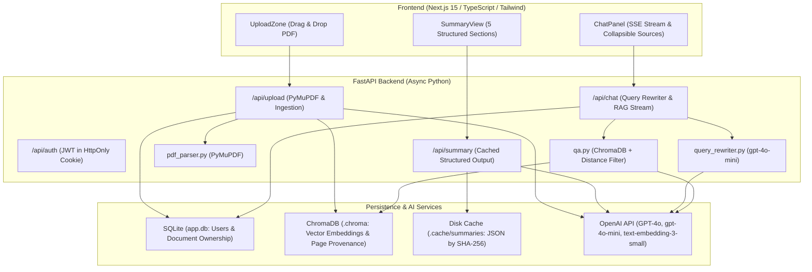
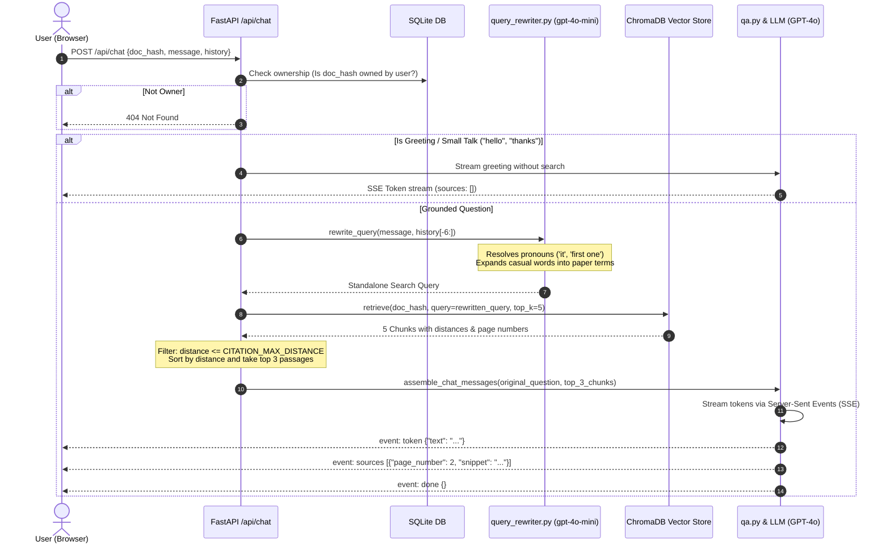

# Research Assistant

A full-stack, production-ready research assistant application designed for researchers and engineers. Upload academic papers in PDF format, receive an instant, structured 5-section summary, and converse through an interactive natural-language chat interface grounded in the paper's contents with page-level citations.

[](docs/spec.md)
[](docs/design.md)

> 📖 **Comprehensive Documentation**:
> - [**System Specification & Acceptance Criteria**](docs/spec.md): Complete functional specifications, API contracts, RAG grounding constraints, authentication rules, and acceptance criteria.
> - [**Architecture & UI Design Guide**](docs/design.md): Consolidated design system, component hierarchy, KaTeX math notation architecture, security boundary, universal multilingual policy, and AWS/Docker deployment topologies.

---

## Key Features

- **Single PDF Upload & Ingestion**: Strict validation of `application/pdf`, 20MB default size limit, SHA-256 content deduplication, and automated rejection of scanned/image-only PDFs.
- **Structured 5-Section Summary**: Generated with strict Pydantic schema validation (`SummarySchema`):
  1. *Title, Authors & Abstract*
  2. *Problem Statement*
  3. *Methodology*
  4. *Key Results*
  5. *Conclusion*  
  Includes automatic 1-retry schema validation and persistent disk caching keyed by SHA-256.
- **KaTeX Mathematical Notation Rendering**:
  - Full support for inline `\(...\)` (or `$ ... $`) and display block `\[...\]` (or `$$ ... $$`) LaTeX equations.
  - Rendered across both structured summary cards and conversational chat message bubbles.
  - Automatic code-block isolation ensures syntax inside backticks (`` ` `` / ```` ``` ````) remains unparsed.
  - Horizontal scrolling enabled on block formulas (`.katex-display`) to prevent mobile/split-screen layout breakage.
- **Strict Content Security & HTML Sanitization**:
  - Model and PDF outputs are treated strictly as untrusted text.
  - Markdown renderer operates without `rehype-raw`, completely eliminating stored XSS vulnerabilities. Raw HTML tags (e.g., `<script>`, ``) render as safe, escaped literal text entities.
- **Universal Multilingual Q&A Policy**:
  - **Native Script Enforcement**: Answers in the user's language using its official native script (e.g., Sinhala Unicode script `සිංහල අකුරු` for Sinhala and Singlish queries).
  - **Phonetic Slang Suppression**: Refuses romanised phonetic slang, translating colloquial intent into grammatically correct native script.
  - **Technical Term Preservation**: Specialized academic terminology, variables, and named entities (e.g., *Transformer architecture*, *BLEU score*) survive in standard English form.
  - **Immutable English Fallback Contract**: Ungrounded queries strictly return the English fallback string (`"The uploaded paper does not contain information to answer this question."`) across all languages, ensuring reliable automated citation suppression.
- **Natural-Language RAG Chat**:
  - **Conversational Query Rewriting**: Resolves pronouns (*"it"*, *"the first one"*, *"they"*) and casual phrasing into standalone academic queries using `gpt-4o-mini` with conversation history before vector search.
  - **Accurate Provenance Citations**: Returns at most 3 top-ranked sources based on cosine distance. Shows page numbers directly from stored PDF metadata with complete-sentence verbatim snippets ($\le 200$ chars).
  - **Collapsed Citations UI**: Answers display a clean, collapsed `"Sources (N)"` dropdown that expands without cluttering the answer text.
  - **Strict Grounding & Fallback**: Answers are grounded strictly in paper excerpts. Returns a verbatim fallback sentence when the text does not contain the answer, and cleanly suppresses citations for small talk, greetings, and ungrounded replies.
- **Authentication & User Data Isolation**:
  - Secure email/password authentication using bcrypt password hashing.
  - JWT session tokens stored in secure, `HttpOnly`, `SameSite=Lax` cookies.
  - SQLite database (`app.db`) isolating uploaded documents, summaries, and chat sessions to the authenticated owner.
- **Crash & Restart Resilience**:
  - Summaries are persisted in `.cache/summaries/{doc_hash}.json`.
  - Vectors and chunks are stored permanently in ChromaDB collections (`.chroma/doc_{doc_hash[:32]}`).
  - Full paper text can be rehydrated from ChromaDB chunks if the backend restarts.

---

## Architecture & Workflows

### System Architecture



### RAG Chat Execution Flow



---

## Tech Stack

- **Backend**:
  - Python 3.11+ (asyncio, FastAPI)
  - PyMuPDF (`fitz`) for PDF parsing
  - ChromaDB for persistent vector storage and cosine similarity search
  - OpenAI Python SDK (`gpt-4o`, `gpt-4o-mini`, `text-embedding-3-small`)
  - SQLAlchemy & SQLite for relational user management and document ownership
  - Pydantic v2 & Pydantic Settings
- **Frontend**:
  - Next.js 15 (App Router)
  - React 19 & TypeScript 5.7+
  - Tailwind CSS 3.4 & Lucide Icons
  - Vitest & React Testing Library

---

## Repository Layout

```
/
├── AGENTS.md                  # Development instructions & constraints
├── README.md                  # Project documentation
├── docs/
│   ├── spec.md                # Detailed application specification
│   └── design.md              # Architectural & UI design decisions
├── backend/
│   ├── app/
│   │   ├── main.py            # FastAPI entry point & CORS configuration
│   │   ├── api/               # API routes: auth, upload, summary, chat, health
│   │   ├── services/          # pdf_parser, summarizer, qa, query_rewriter, auth_service, cache
│   │   ├── schemas/           # Pydantic models: auth, upload, summary, chat
│   │   ├── models/            # SQLAlchemy models: user, document_ownership
│   │   ├── db/                # Database engine & session management
│   │   └── core/              # config.py, dependencies.py
│   ├── tests/                 # 150+ unit, integration, and smoke tests
│   │   ├── test_auth_session.py
│   │   ├── test_auth_signup_signin.py
│   │   ├── test_cache.py
│   │   ├── test_chat_endpoint.py
│   │   ├── test_natural_chat.py
│   │   ├── test_ownership.py
│   │   ├── test_pdf_parser.py
│   │   ├── test_retrieval.py
│   │   ├── test_summarizer.py
│   │   └── test_e2e_smoke.py
│   ├── scripts/
│   │   ├── calibrate_citation_threshold.py
│   │   └── generate_scanned_pdf.py
│   ├── requirements.txt
│   └── .env.example
└── frontend/
    ├── app/
    │   ├── layout.tsx         # Root layout with auth provider & responsive shell
    │   ├── page.tsx           # Main workspace (Upload, Summary, Chat)
    │   ├── signin/page.tsx    # Sign-in page
    │   ├── signup/page.tsx    # Sign-up page
    │   └── globals.css
    ├── components/            # UploadZone, SummaryView, ChatPanel, SourceCard, AuthForms
    ├── lib/
    │   ├── api.ts             # Typed API client
    │   └── sse.ts             # SSE parser
    ├── package.json
    ├── vitest.config.mts
    └── .env.local.example
```

---

## Getting Started

### 1. Prerequisites

- **Python**: 3.11 or later
- **Node.js**: 20.9 or later
- **Tesseract OCR**: Required on the host system to process scanned or image-only PDFs (`tesseract-ocr` on Ubuntu/Debian, `tesseract` on Fedora/macOS).
- **OpenAI API Key**: Required for live summarization, query rewriting, and chat answering. (All test suites run completely offline with mocked providers.)

---

### 2. Backend Setup

From the repository root:

```bash
cd backend

# Create and activate virtual environment
python3 -m venv venv
source venv/bin/activate

# Install dependencies
pip install -r requirements.txt

# Configure environment variables
cp .env.example .env
# Edit .env and supply your OPENAI_API_KEY and AUTH_SECRET_KEY

# Start backend dev server
uvicorn app.main:app --reload --port 8000
```

Verify backend health at [http://localhost:8000/health](http://localhost:8000/health) (`{"status":"ok"}`).

---

### 3. Frontend Setup

In a separate terminal from the repository root:

```bash
cd frontend

# Install dependencies
npm ci

# Configure environment variables
cp .env.local.example .env.local

# Start frontend dev server
npm run dev
```

Open [http://localhost:3000](http://localhost:3000) in your browser.

---

## Environment Variables

### Backend (`backend/.env`)

| Variable | Default | Description |
| :--- | :--- | :--- |
| `LLM_PROVIDER` | `openai` | LLM provider backend (`openai`). |
| `OPENAI_API_KEY` | `""` | API key for OpenAI or OpenAI-compatible provider. |
| `OPENAI_BASE_URL` | `https://api.openai.com/v1` | Base URL for OpenAI-compatible endpoint. |
| `MODEL_NAME` | `gpt-4o` | Chat & summarization model name. |
| `REWRITE_MODEL` | `gpt-4o-mini` | Model used for conversational query rewriting. |
| `REWRITE_HISTORY_TURNS` | `3` | Conversation history turns sent to query rewriter. |
| `EMBEDDING_MODEL` | `text-embedding-3-small` | Vector embedding model name. |
| `MAX_UPLOAD_MB` | `20` | Maximum allowed PDF file size in MB. |
| `CITATION_MAX_DISTANCE` | `0.6` | Cosine distance cutoff threshold for citation retrieval. |
| `CORS_ORIGINS` | `http://localhost:3000` | Comma-separated allowed origins. |
| `SUMMARY_CACHE_DIR` | `.cache/summaries` | Directory for disk-persisted summaries. |
| `CHROMA_DIR` | `.chroma` | Directory for persistent ChromaDB storage. |
| `ENVIRONMENT` | `development` | Runtime environment (`development` or `production`). |
| `AUTH_SECRET_KEY` | `""` | Secret key for signing JWT tokens. Required in production. |
| `AUTH_TOKEN_TTL_MINUTES` | `60` | Session token time-to-live in minutes. |
| `DATABASE_URL` | `sqlite:///./data/app.db` | SQLAlchemy database URL for users and ownership. |

To generate a secure random string for `AUTH_SECRET_KEY`:
```bash
python -c "import secrets; print(secrets.token_urlsafe(48))"
```

### Frontend (`frontend/.env.local`)

| Variable | Default | Description |
| :--- | :--- | :--- |
| `NEXT_PUBLIC_API_BASE_URL` | `http://localhost:8000` | Backend API URL reachable by the browser. |

---

## Testing & Quality Assurance

Both the backend and frontend include thorough automated test suites that run without requiring live network access or paid API keys.

### Backend Verification

Run from `backend/`:

```bash
cd backend

# Run full test suite (219 tests across unit, integration, and smoke suites)
pytest -v

# Run linting
ruff check .

# Run format check
ruff format --check .
```

### Frontend Verification

Run from `frontend/`:

```bash
cd frontend

# Run unit and component tests (105 tests across Markdown, KaTeX, Auth, and RAG components)
npm test

# Linting
npm run lint

# Strict TypeScript type check
npx tsc --noEmit

# Production build test
npm run build
```

---

## Citation Threshold Calibration

`CITATION_MAX_DISTANCE` controls the cosine distance cutoff for retrieval. If you change `EMBEDDING_MODEL` or tune sensitivity, run the built-in calibration script:

```bash
cd backend
python scripts/calibrate_citation_threshold.py \
  --doc-hash <DOC_HASH> \
  --on-topic "What were the key results?" "What was the sample size?" \
  --off-topic "What is the capital of France?" "How to bake a cake?"
```

The script reports group distances and suggests an optimal cutoff threshold.

---

## Known Considerations

- **Single-Server SQLite**: User records and document ownership are stored in local SQLite (`data/app.db`), optimized for single-instance deployments.
- **In-Memory Rate Limiting**: The authentication failure rate limiter maintains state in memory and resets upon server restart.
- **Scanned PDFs & OCR**: Scanned PDFs are processed with OCR. Accuracy depends on scan quality. OCR is slower than text extraction.
