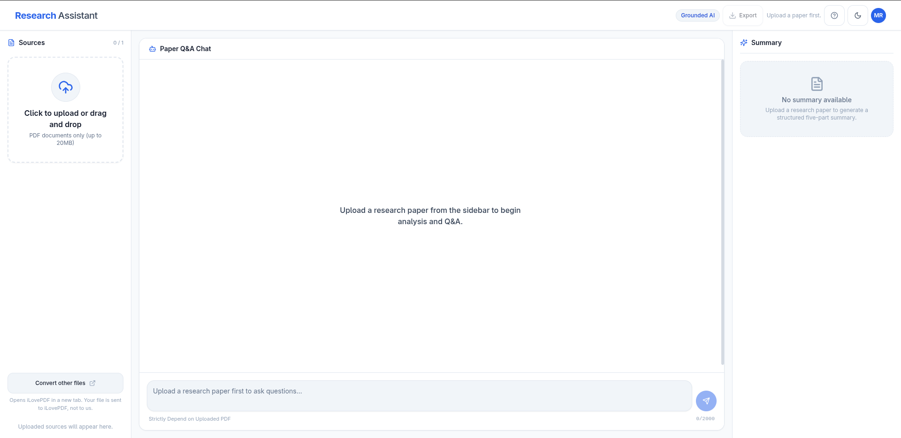

# Research Assistant

A full-stack, production-ready research assistant application designed for researchers, scientists, and engineers. Upload academic papers in PDF format, receive an instant, structured 5-section summary, evaluate academic credibility metrics, inspect documents via an integrated PDF viewer, export executive reports to Microsoft Word (`.docx`), and converse through an interactive natural-language chat interface grounded in the paper's contents with page-level citations and multi-section dual-pass retrieval.

[](docs/spec.md)
[](docs/design.md)
[](docs/specs/multi_section_retrieval.md)

> 📖 **Comprehensive Documentation**:
> - [**System Specification & Acceptance Criteria**](docs/spec.md): Complete functional specifications, API contracts, RAG grounding constraints, authentication rules, and acceptance criteria.
> - [**Architecture & UI Design Guide**](docs/design.md): Consolidated design system, component hierarchy, KaTeX math notation architecture, security boundaries, universal multilingual policy, and AWS/Docker deployment topologies.
> - [**Multi-Section Retrieval Specification**](docs/specs/multi_section_retrieval.md): Specification for cross-section comparative inquiry, structured classification flags, and dual-pass retrieval pipelines.

---

## Application Preview

### Desktop View
The responsive 3-column desktop workspace integrates the **Source & Ingestion** panel (left), the **Paper Q&A Chat** with suggestion chips (center), and the **Structured 5-Section Summary** with KaTeX support (right).



### Mobile View
A touch-friendly mobile interface with clean bottom navigation tabs (**Source**, **Chat**, **Summary**) optimized for mobile viewports.

<p align="center">
  
</p>

---

## Functional Requirements

1. **Document Upload**: Users can upload a single research paper (at once) in PDF format.
2. **Structured Summary Generation**:
   - On upload, automatically generate a summary with the following 5 sections:
     - *Title & Authors and Abstract*
     - *Problem Statement*
     - *Methodology*
     - *Key Results*
     - *Conclusion*
   - Display the summary in an interactive, readable format.
3. **Question Answering Chatbot**:
   - Enable users to ask natural-language questions about the uploaded paper, fully grounded in the document content via RAG flows with citations.

---

## Key Features

- **Single PDF Upload & Ingestion**: Fast PDF parsing via PyMuPDF with SHA-256 deduplication, 20MB limit, and automatic OCR fallback for scanned documents.
- **Structured 5-Section Summary**: Generates *Title/Abstract*, *Problem*, *Methodology*, *Results*, and *Conclusion* with strict Pydantic validation and persistent disk caching.
- **Cross-Section Comparison & Dual-Pass Retrieval**: Answers comparative queries (e.g. Abstract vs. Results) using structured intent classification and dual-pass chunk retrieval.
- **Interactive Persona Suggestion Chips**: Quick-start prompt chips tailored for **Reader Mode** (findings, methods) and **Author Mode** (limitations, improvements).
- **Executive Word Export (`.docx`)**: One-click download of styled `.docx` reports containing paper metadata, executive summary, and full Q&A transcripts.
- **Academic Credibility Scoring**: Real-time bibliometric verification (h-index, citation count, open access status) queried strictly by title/DOI via OpenAlex.
- **Built-in PDF Viewer**: Side-by-side reading of the original paper in a responsive drawer with automated memory cleanup.
- **KaTeX Math Notation**: Native inline (`\(...\)`) and display block (`\[...\]`) LaTeX rendering across summary cards and chat messages.
- **Strict Content Security**: Zero stored XSS via safe markdown rendering without raw HTML execution.
- **Universal Multilingual Q&A**: Answers in official native script, preserving English technical terms, with immutable fallback for ungrounded questions.
- **Smart Intent Classification**: Distinguishes casual day-to-day chat, greetings, and off-topic trivia from paper inquiries, responding naturally without unnecessary vector searches or hallucinated citations.
- **Natural-Language RAG Chat**: Context-aware query rewriting, cosine-distance filtered retrieval, and collapsible page-level citations.
- **Authentication & User Data Isolation**: Secure email/password login with JWT in HttpOnly cookies, scoping documents and chats to each user in SQLite.
- **Crash & Restart Resilience**: Persistent disk-backed summaries and ChromaDB vector collections enable instant session recovery after server restarts.

---

## Document Credibility Scoring

The application computes an objective 100-point credibility score (plus up to 5 bonus points for reproducibility) to evaluate paper reliability:

| Dimension | Max Points | Evaluation Criteria |
| :--- | :---: | :--- |
| **Venue & Indexing** | **35 pts** | Verified indexing record in the OpenAlex academic registry with $\ge 85\%$ title match. |
| **Citation Impact** | **25 pts** | Citation volume normalized by publication recency (recent papers receive a fair baseline). |
| **Reference Density** | **20 pts** | Bibliography breadth and citation depth ($\ge 20$ references = 20 pts, 10–19 = 15 pts). |
| **Academic Affiliation** | **10 pts** | Author affiliation verified via OpenAlex institutional records or `.edu` / `.ac.*` / `.gov` front-matter markers. |
| **Structural Rigor** | **10 pts** | Detection of standard scientific sections (*Introduction*, *Methodology*, *Results*, *Conclusion*). |
| **Open Science Bonus** | **+5 pts** | Reproducibility bonus for linked open artifacts (GitHub repositories, Zenodo/HuggingFace datasets). |

> 🔒 **Privacy Guarantee**: Credibility checks query OpenAlex strictly by extracted paper title or DOI string. Document body text, chunk embeddings, chat history, and user identities are never transmitted to external services.

---

## Tech Stack

- **Backend**:
  - Python 3.11+ (asyncio, FastAPI)
  - PyMuPDF (`fitz`) for PDF text parsing & OCRmyPDF (`ocrmypdf` + Tesseract) for scanned documents
  - ChromaDB for persistent vector storage and cosine similarity search
  - OpenAI Python SDK (`gpt-4o`, `gpt-4o-mini`, `text-embedding-3-small`)
  - `python-docx` for structured Word report generation
  - `httpx` for async OpenAlex API client integration
  - SQLAlchemy & SQLite for relational user management and document ownership
  - Pydantic v2 & Pydantic Settings
- **Frontend**:
  - Next.js 15 (App Router)
  - React 19 & TypeScript 5.7+
  - Tailwind CSS 3.4 & Lucide Icons
  - KaTeX for LaTeX mathematical typesetting
  - Vitest & React Testing Library

---

## Getting Started

### 1. Prerequisites

- **Python**: 3.11 or later
- **Node.js**: 20.9 or later
  # Testing OCR & Scanned PDFs

  The application provides automated fallback to OCRmyPDF when an uploaded PDF does not contain an extractable text layer.

  To test OCR handling before uploading real papers:
- **OCR Dependencies (Tesseract OCR & Ghostscript)**:
  `ocrmypdf` (in `backend/requirements.txt`) processes scanned/image-only PDFs (standard digital PDFs do not require OCR):
  - **Ubuntu / Debian**: `sudo apt-get install -y tesseract-ocr ghostscript`
  - **Fedora / RHEL**: `sudo dnf install -y tesseract ghostscript`
  - **macOS**: `brew install tesseract ghostscript`
  - **Windows**: `winget install UB-Mannheim.TesseractOCR ArtifexSoftware.Ghostscript` (or use WSL2)
- **OpenAI API Key**: Required for live summarization, query classification, and chat answering. (All test suites run completely offline with mocked providers.)

---

### 2. Backend Setup

From the repository root:

```bash
cd backend

# Create and activate virtual environment
python3 -m venv venv
source venv/bin/activate

# Install dependencies (includes ocrmypdf, pymupdf, chromadb, fastapi)
pip install -r requirements.txt

# Configure environment variables
cp .env.example .env
# Edit .env and supply your OPENAI_API_KEY

# Start backend dev server
uvicorn app.main:app --reload --port 8000
```

Verify backend health at [http://localhost:8000/health](http://localhost:8000/health) (`{"status":"ok"}`).

---

### 3. Frontend Setup

In a separate terminal from the repository root:

```bash
cd frontend

# Install dependencies
npm ci

# Configure environment variables
cp .env.local.example .env.local

# Start frontend dev server
npm run dev
```

Open [http://localhost:3000](http://localhost:3000) in your browser.

---

## Testing & Quality Assurance

Both the backend and frontend include comprehensive automated test suites that run without requiring live network access or paid API keys.

### Backend Verification

Run from `backend/`:

```bash
cd backend

# Run full test suite (227+ passed tests across 28 unit, integration, and smoke test suites)
pytest -v

# Run linting
ruff check .

# Run format check
ruff format --check .
```

### Frontend Verification

Run from `frontend/`:

```bash
cd frontend

# Run unit and component tests (118 passed tests across Markdown, KaTeX, Auth, and UI suites)
npm test

# Linting
npm run lint

# Strict TypeScript type check
npx tsc --noEmit

# Production build test
npm run build
```

---

## Known Considerations

- **Single-Server SQLite**: User records and document ownership are stored in local SQLite (`data/app.db`), optimized for single-instance deployments.

- **In-Memory Rate Limiting**: The authentication failure rate limiter maintains state in memory and resets upon server restart.
- **Scanned PDFs & OCR**: Scanned PDFs are processed with OCRmyPDF. Accuracy depends on scan quality and image resolution. OCR processing is naturally slower than native vector text extraction.
